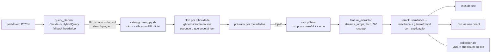

# osu-semantic-recommender

  

> Recomendador **semântico e mecânico** de beatmaps de osu!: você descreve em linguagem natural o que quer jogar ou treinar, ele procura no catálogo do [osu.ppy.sh/beatmapsets](https://osu.ppy.sh/beatmapsets), confere a mecânica real de cada mapa e devolve links, `.osz` para baixar e uma coleção pronta para o jogo (`collection.db`).

```
$ python -m src.cli recommend "quero mapas de 5.2★ com jumps técnicos, rock japonês energético e poucas streams longas para treinar aim" --limit 8 --download out/osz

planner: llm:claude_code:default   filtros: stars>4.895 stars<5.505   maior stream ≤ 12
catálogo: catboy · 300 mapsets lidos · 259 candidatos · 39 analisados (.osu)
 # score  beatmap                                                    por quê
 1 0.667  Kano - Sukisuki Zecchoushou [Expert]                       5.29★ 234BPM AR9.2; jumps 0.47; tech 0.80; maior stream 0; gênero: jrock, rock
          https://osu.ppy.sh/beatmapsets/2598024#osu/5806042
 2 0.654  SLAVE.V-V-R feat. Kasane Teto - Natsumi [Furor's Insane]  5.00★ 210BPM AR9.1; jumps 0.59; tech 0.53; maior stream 3; gênero: jrock, rock
          https://osu.ppy.sh/beatmapsets/2601596#osu/5884878
 ...
```

## Início rápido

Requisitos: Python 3.11+ e internet. Não precisa de conta no osu! nem de chave de API.

```bash
git clone https://github.com/<usuario>/osu-semantic-recommender.git
cd osu-semantic-recommender
python -m venv .venv
source .venv/bin/activate          # Windows (PowerShell): .venv\Scripts\Activate.ps1
pip install -r requirements.txt
python -m src.cli recommend "jumps técnicos de rock japonês, 5.2 estrelas, sem streams" --limit 10
```

Para o Claude entender pedidos livres, instale o [Claude Code](https://code.claude.com/docs), faça login uma vez (`claude` → `/login`) e confira com `python -m src.cli doctor`. Sem ele, o programa usa regras fixas.

📘 **[Guia de uso completo](docs/GUIA_DE_USO.md)**: como escrever pedidos precisos, ler o resultado, baixar os mapas e criar a coleção no jogo.

---

## 1. Problema

O catálogo do osu! tem dezenas de milhares de mapsets ranked. Para achar mapas bons para uma sessão de treino, o jogador precisa cruzar dois tipos de informação que **nenhuma ferramenta existente combina**:

| Tipo | Exemplo | Onde está | Quem resolve bem |
|---|---|---|---|
| **Mecânica** (numérica, exata) | "5.2★", "jumps técnicos", "sem streams longas", "AR 9.3+" | nos hit objects do arquivo `.osu` | código determinístico |
| **Semântica** (vaga, cultural) | "rock japonês energético", "algo calmo pra aquecer", "abertura de anime" | gênero/idioma do site, tags, conhecimento sobre artistas | metadados + LLM |

A busca do site filtra estrelas, BPM e AR, mas não sabe o que tem **dentro** do mapa: não existe filtro de "tamanho de stream", "jumps" ou "técnico". O projeto junta os dois mundos com uma arquitetura em que **cada componente faz só aquilo em que é confiável**.

## 2. Arquitetura



Também existe o modo `--local`, que indexa a sua pasta Songs no ChromaDB e busca só no que você já tem: mesmo planner, mesmas features, mesma função de score.

**Por que baixar o `.osu` de cada candidato?** O catálogo informa estrelas, BPM e AR, mas não os padrões do mapa. O pipeline usa o catálogo para afunilar barato (centenas de mapsets → dezenas de candidatos) e só então baixa o `.osu` dos melhores (≈20–60 KB cada, com cache) para medir stream, jump e tech de verdade. É isso que permite cumprir "poucas streams longas" com exatidão.

**Fontes do catálogo** (`src/catalog/sources.py`):

| Fonte | Quando | Observações medidas |
|---|---|---|
| mirror catboy.best | padrão, sem conta | entende `stars>…` e `bpm>…` na query, mas por **mapset** e com BPM/duração só inteiros; ignora gênero/idioma, então há uma passada textual extra pelo gênero (ex.: `classical stars>4`) e o filtro exato é refeito por dificuldade |
| API oficial v2 | com `OSU_CLIENT_ID`/`OSU_CLIENT_SECRET` (app OAuth grátis) | filtros documentados, incluindo gênero (`g`) e idioma (`l`) |
| `osu.ppy.sh/osu/{id}` | sempre | `.osu` público de qualquer dificuldade; o MD5 bate com o `checksum` do catálogo |
| osu.direct | `--download` | `.osz` completo |

### Decisões de design

1. **Determinístico onde dá, LLM onde agrega.** Star rating, tamanho de stream, distância de jump, variância de ângulo, entropia de ritmo e mudanças de SV são *calculados*, nunca "estimados" por um modelo. O LLM recebe essas métricas e é instruído a não contradizê-las; sua função é gênero, mood e descrição em linguagem natural (`src/parser/feature_extractor.py`, `src/indexer/enrichment.py`).
2. **LLM local via Claude Code, sem API key.** O backend padrão (`LLM_BACKEND=claude_code`) chama o Claude Code instalado na máquina em modo headless: `claude -p --output-format json --json-schema <schema Pydantic> --tools ""`. A autenticação é a da sua conta no Claude Code; o projeto não guarda nenhuma credencial. O pedido vai por stdin, o processo roda num diretório neutro (não carrega o `CLAUDE.md` do projeto), sem ferramentas, sem MCP e sem gravar sessão. Um *circuit breaker* detecta "não autenticado" na primeira chamada e evita gastar um subprocesso por beatmap.
3. **Structured Outputs como contrato, em qualquer backend.** O Claude Code recebe o JSON Schema gerado do modelo Pydantic (`--json-schema`) e a resposta é validada de novo com Pydantic; no backend `anthropic_api` o mesmo modelo vai em `client.beta.messages.parse(output_format=...)`, com recusas e truncamento tratados e fallback de recusa server-side ligado. Planner e enriquecimento não sabem qual backend está ativo (`src/llm.py`).
4. **Degradação graciosa.** Sem Claude Code instalado/logado (ou com `LLM_BACKEND=none`), tudo continua funcionando: planner heurístico (regex PT/EN com negação: "poucas streams longas", "nada de streams") e enriquecimento por template. Os dois caminhos produzem o *mesmo schema*, então o resto do sistema não sabe a diferença. Falhas de LLM caem para o caminho determinístico com log.
5. **Busca híbrida com relaxamento explícito.** Filtros numéricos viram filtros nativos do catálogo do osu! (ou `where` do Chroma no modo `--local`), os candidatos são afunilados por metadados e um rerank combina `0.35·semântica + 0.40·aderência mecânica + 0.25·match gênero/mood`. Se sobrar pouca coisa, os filtros são relaxados **em passos registrados**, e os itens relaxados ficam marcados e abaixo dos estritos (`src/recommender/online_search.py`, `hybrid_search.py`).
6. **Explicabilidade.** Cada recomendação traz os componentes do score e os motivos ("maior stream 3", "gênero: jrock", "penalidade: long_streams").
7. **Saída utilizável.** Links para o site, download dos `.osz` (`--download`) e mapsets que você já tem escondidos por padrão (lidos da pasta Songs). **Exportação segura:** `collection.db` é escrito em binário conforme o formato do osu!stable (ULEB128 + strings osu!), com auto-verificação (relê o que escreveu), *merge* com as coleções existentes do jogador e backup automático (`src/recommender/db_exporter.py`).
8. **Observabilidade.** Cada etapa abre um span (latência, modelo, tokens, cache hits, nº de candidatos, relaxamentos) gravado em `.osr_data/traces.jsonl`, com spans aninhados sob um `trace_id` por requisição (`src/observability.py`).
9. **Custo controlado.** Enriquecimento é feito uma vez por MD5 e cacheado (`.osr_data/enrichment_cache.json`), com chamadas paralelas (`LLM_CONCURRENCY`); indexação é incremental. O modelo de cada etapa é configurável (`PLANNER_MODEL`, `ENRICHMENT_MODEL`; no Claude Code aceita `opus`/`sonnet`/`haiku`).

### Estrutura

```text
src/
├── config.py               # pydantic-settings (.env)
├── llm.py                  # backends LLM (Claude Code local | API | none), Structured Outputs, spans
├── observability.py        # logging Rich + spans JSONL
├── parser/
│   ├── osu_parser.py       # .osu -> Beatmap (metadados, timing, hit objects, MD5)
│   └── feature_extractor.py# Beatmap -> MapFeatures (SR, streams, jumps, tech, scores 0..1)
├── indexer/
│   ├── enrichment.py       # MapEnrichment via LLM (cache) ou template
│   ├── embeddings.py       # HashEmbedder (offline, PT/EN) | FastEmbedder (multilíngue)
│   ├── vector_store.py     # ChromaDB com metadados filtráveis
│   └── pipeline.py         # indexação incremental
├── catalog/
│   ├── sources.py          # catálogo online: mirror catboy | API oficial v2
│   ├── models.py           # OnlineSet/OnlineBeatmap, ids de gênero/idioma do osu!
│   └── files.py            # .osu público (cache), .osz (osu.direct), mapsets já instalados
├── recommender/
│   ├── query_planner.py    # HybridQuery (LLM | heurístico)
│   ├── online_search.py    # catálogo -> filtro por dificuldade -> pré-rank -> .osu -> rerank
│   ├── hybrid_search.py    # busca local (ChromaDB) + score compartilhado + relaxamento
│   └── db_exporter.py      # leitura/escrita/merge de collection.db
└── cli.py                  # Typer + Rich
data/
├── generate_samples.py     # gera os .osu sintéticos (determinístico)
└── sample_beatmaps/        # 18 mapas sintéticos com perfis mecânicos distintos (testes/evals offline)
evals/
├── test_queries.json       # 18 pedidos difíceis (14 dev + 4 held-out) com gabarito
├── run_evals.py            # planner + retrieval offline (gate de CI: --min-p5)
├── run_online_checks.py    # checagem ao vivo: os resultados online cumprem o pedido?
└── results/                # baselines versionadas (heurístico, Claude, online)
tests/                      # pytest (parser, exporter, planner, busca local/online, LLM e catálogo simulados)
docs/GUIA_DE_USO.md         # guia passo a passo para usuários
.github/workflows/ci.yml    # testes + evals offline em Python 3.11 e 3.12
```

### Features mecânicas (resumo)

| Feature | Como é calculada |
|---|---|
| `star_rating`, `aim_sr`, `speed_sr` | `rosu-pp-py` (port do algoritmo oficial); fallback aproximado marcado em `sr_source` |
| `max_stream_len`, `n_bursts` / `n_streams` / `n_long_streams` | runs de notas consecutivas a ≤ 1/4 de batida (3–6, 7–15, ≥16) |
| `jump_ratio`, `avg_jump_dist`, `avg_jump_velocity` | transições 1/2–1/1 com distância ≥ 1,6 diâmetros e velocidade de cursor ≥ 0,62 px/ms |
| `angle_std`, `acute/obtuse_angle_ratio` | ângulos entre movimentos de aim (fora de streams) |
| `rhythm_variety` | fração de notas (a partir de círculos) **fora** dos dois snaps mais comuns: mede *mistura* de ritmos, então um mapa todo em 1/3 é consistente (≈0) |
| `sv_distinct`, `sv_spread` | nº de valores de SV distintos e razão SV máx/mín |
| `avg_spacing`, `obtuse_angle_ratio`, velocidade de cursor | base do `flow_score` |
| `bursts_per_min` | bursts (3–6 notas) por minuto |
| `aim/speed/stamina/tech/flow/reading_score` ∈ [0,1] | combinações normalizadas das métricas acima → `skills` |

**Calibração em mapas reais.** A primeira versão dos limites foi ajustada nos mapas sintéticos e, numa biblioteca real (99 mapas ranked), marcava `tech` em 98% dos mapas, `sliders` em 81% e `flow_aim` em 67%. Mapas reais quase sempre têm alguma mudança de SV, ângulos variados (`angle_std` entre 35 e 48) e cerca de 49% de sliders, e o intervalo início→início de um slider distorce o ritmo. Agora as métricas medem só os extremos dessa distribuição: ritmo medido só a partir de círculos, SV por valores distintos, e flow exigindo velocidade de cursor (Easy/Normal são "fluidos", mas lentos). Resultado na mesma biblioteca: `tech` 33%, `sliders` 23%, `flow_aim` 5%, e os mapas marcados como técnicos são os esperados (ex.: cYsmix - Peer Gynt, The Flashbulb - Mellann). O gerador sintético também foi corrigido para produzir "tech" realista (mistura de 1/3, 3/4 e 1/4 e SV variado).

## 3. Evals

Há duas camadas: evals **offline e reprodutíveis** (planner + retrieval sobre um corpus fixo) e uma **checagem ao vivo** da busca online.

### 3.1 Busca online: os resultados cumprem o pedido?

O catálogo muda todo dia, então não existe gabarito fixo de "mapas certos". `evals/run_online_checks.py` mede o que não depende do dia: em cada um de 6 pedidos, que fração do top 10 **respeita** as faixas numéricas (conferidas nos valores oficiais do site), o limite de stream (conferido no `.osu` real), o gênero pedido e as skills pedidas. Resultado com o planner Claude (`evals/results/baseline-online-llm.json`):

| Pedido | Faixas | Limite de stream | Gênero | Skills | Tempo |
|---|---|---|---|---|---|
| 5.2★, jumps técnicos, rock japonês, poucas streams longas | 100% | 100% | 100% | 100% | 26 s |
| deathstreams de metal acima de 6★ | 100% | 100% | 100% | 100% | 34 s |
| anime entre 4 e 5★, AR 9, sem streams | 100% | 100% | 100% | — | 29 s |
| eletrônica de 180 BPM com streams, até 5.5★ | 100% | 100% | 100% | 90% | 33 s |
| j-pop alegre com jumps, 4.5★ | 100% | 100% | 100% | 80% | 20 s |
| técnicos de música clássica entre 4 e 6★ | 100% | 100% | 100% | 100% | 32 s |

Esse eval pegou dois bugs antes de virarem problema seu: (1) o mirror devolve **vazio** quando o filtro de BPM tem casas decimais (`bpm>174.995`), então "eletrônica de 180 BPM" voltava sem nenhum mapa; e (2) o mirror ignora o filtro de gênero, então "música clássica" trazia só 40% de mapas clássicos. As correções foram BPM/duração como inteiros e uma passada textual pelo gênero, ambas com teste.

O tempo é dominado pelo download dos `.osu` na primeira vez (dezenas de arquivos pequenos); pedidos parecidos depois reaproveitam o cache.

### 3.2 Planner e retrieval (offline)

`evals/test_queries.json` tem 18 pedidos difíceis (PT/EN, negações, faixas, gênero + mecânica). Cada um define:
- `expected`: o que o planner deveria extrair (avaliado campo a campo, faixas com tolerância);
- `relevance`: predicados sobre features/enriquecimento que definem os mapas relevantes do índice;
- `must_top3`: respostas-ouro.

O runner separa **qualidade do planner** de **qualidade do retrieval** para mostrar onde o sistema erra, e divide o dataset em **dev** (14 queries escritas junto com o planner heurístico) e **held-out** (4 paráfrases/gírias escritas depois, que o heurístico nunca viu).

Resultados (embeddings hash e enriquecimento por template nos dois casos, para isolar o efeito do planner; `evals/results/baseline-*.json`):

| Planner | Split | Campos do planner | Planos exatos | P@5 | R@10 | nDCG@5 | hit@3 | Latência/plano |
|---|---|---|---|---|---|---|---|---|
| Heurístico | dev (14) | 100% | 100% | 0.893 | 1.000 | 0.983 | 100% | <1 ms |
| Heurístico | **held-out (4)** | **51.7%** | **0%** | **0.417** | **0.500** | **0.383** | **50%** | <1 ms |
| Claude (via Claude Code) | dev (14) | 97.6% | 93% | 0.929 | 1.000 | 0.989 | 100% | ~4,6 s |
| Claude (via Claude Code) | **held-out (4)** | **95.0%** | **75%** | **0.917** | **1.000** | **0.971** | **100%** | ~6,3 s |

**Leitura honesta:**
- Os 100% do heurístico no dev são overfitting esperado: as regras e o dataset foram escritos juntos. O held-out mostra onde as regras quebram: "5 estrelas e pouco", "nada muito streamado", "banda japonesa", "nothing over 4 stars" (a regex lê "over 4" como mínimo) e "sem AR alto" (a negação vira o filtro `AR ≥ 9.6` e elimina a resposta certa).
- O Claude generaliza: acerta quase todo o held-out sem ter sido ajustado para ele. O preço é latência (~5 s por plano contra <1 ms) e uso do plano Claude. Por isso o heurístico continua como fallback.
- O único campo que o Claude "erra" no dev (q05, "jumps grandes com AR alto") é ambiguidade da especificação: sem número, ele tratou "AR alto" como preferência (`high_ar`) em vez de filtro rígido `AR ≥ 9.6`, e explicou isso no `rationale`. Isso também evita o erro do heurístico na h04. Não mexi no eval depois de ver o resultado.
- Execuções do planner LLM variam de uma rodada para outra. Numa rodada anterior, o Claude acertou 100% dos campos do held-out; nesta, leu "5 estrelas e pouco" como "≈5" (4.7–5.3) e errou a faixa da h01, mas a busca acertou o top 3 mesmo assim. Para comparar mudanças, rode mais de uma vez.

```bash
python evals/run_evals.py --planner both   # usa o Claude Code local; compara heurístico x LLM lado a lado
```

O eval também já pegou um bug de verdade: com o enriquecimento do Claude, o mapa ideal da consulta principal caiu para 3º, porque o Claude rotulou o gênero como `jrock` e o pedido virou `["jrock", "rock"]`. Agora subgêneros implicam o gênero pai (`GENRE_PARENTS` em `hybrid_search.py`), com teste de regressão.

Outras limitações conhecidas:
- O corpus de avaliação é **sintético** (18 mapas gerados por `data/generate_samples.py`) e pequeno; serve para regressão, não como benchmark absoluto. O próximo passo é rotular uma amostra de mapas reais.
- Na consulta q02 ("deathstreams de metal"), o rerank ainda coloca um mapa de metal *sem* streams em 2º lugar: o peso do gênero às vezes vence a aderência mecânica.
- Gênero vindo do template depende das tags do mapper; com LLM, o enriquecimento usa conhecimento sobre o artista.

Use `--min-p5 0.8` para transformar o eval em gate de CI (exit 1 se o P@5 do split dev ficar abaixo do limiar; o CI do repositório já faz isso).

## 4. Como rodar

O passo a passo detalhado, com Windows e Linux, está no **[Guia de uso](docs/GUIA_DE_USO.md)**. Resumo:

```bash
git clone https://github.com/<usuario>/osu-semantic-recommender.git && cd osu-semantic-recommender
python -m venv .venv && source .venv/bin/activate   # Windows: .venv\Scripts\Activate.ps1
pip install -r requirements.txt
cp .env.example .env            # opcional: nada é obrigatório
```

**Conectar o Claude (sem API key).** Instale o [Claude Code](https://code.claude.com/docs) e faça login uma vez com sua conta:

```bash
curl -fsSL https://claude.ai/install.sh | bash    # ou: npm install -g @anthropic-ai/claude-code
claude                                            # dentro dele: /login  (depois /exit)
python -m src.cli doctor                          # confirma: backend claude_code + resposta estruturada
```

O uso conta na sua assinatura/plano do Claude, como qualquer uso do Claude Code. Se `claude` não estiver no PATH, defina `CLAUDE_CODE_BIN`.

**Buscar no site e baixar** (uso principal; nenhuma conta do osu! é necessária):

```bash
python -m src.cli recommend "20 mapas de anime entre 5 e 6 estrelas com bursts, sem deathstreams"
python -m src.cli recommend "jumps técnicos de rock japonês, 5.2 estrelas" --limit 15 --download out/osz
```

- Cada resultado traz o link da dificuldade no site.
- `--download PASTA` baixa os `.osz`. Abra cada um com duplo clique (o osu! importa) ou mova para a pasta Songs e aperte F5 na seleção de músicas.
- Mapsets que você já tem (pasta Songs autodetectada ou `OWNED_SONGS_DIR`) ficam de fora; use `--include-owned` para mostrá-los.
- `--export collection.db --merge collection.db` grava a coleção. Os mapas aparecem nela assim que os `.osz` forem importados, porque a coleção referencia o MD5, que é o mesmo do site. Feche o osu! antes de exportar (o jogo reescreve `collection.db` ao sair). No **osu!lazer**: Settings → Maintenance → *Import collections from stable*.
- `--enrich` pede ao Claude uma descrição/mood de cada candidato (mais lento, cacheado).

**Buscar só no que você já tem** (`--local`):

```bash
python -m src.cli index --songs-dir ~/.local/share/osu-wine/osu\!/Songs --no-llm
python -m src.cli recommend --local "deathstreams de metal acima de 7 estrelas"
```

Teste 100% offline, sem Claude e sem rede (18 `.osu` sintéticos em `data/sample_beatmaps/`):

```bash
pytest                                              # testes (LLM, catálogo e downloads simulados)
python evals/run_evals.py                           # planner + retrieval no corpus fixo
python evals/run_online_checks.py                   # checagem ao vivo (requer internet)
```

Sem `--no-llm`, o planner usa o Claude Code se ele estiver instalado e logado; se não estiver, avisa uma vez e segue no modo determinístico.

Outros comandos:

```bash
python -m src.cli plan "pedido"           # mostra a HybridQuery (debug do planner)
python -m src.cli recommend "..." --json  # saída para scripts
python -m src.cli inspect mapa.osu        # features determinísticas de um mapa
python -m src.cli stats                   # resumo do índice
python -m src.cli -v recommend "..."      # logs DEBUG com spans
python data/generate_samples.py           # regera os mapas sintéticos
```

### Configuração (`.env`)

| Variável | Padrão | Descrição |
|---|---|---|
| `LLM_BACKEND` | `claude_code` | `claude_code` (Claude Code local, sem chave) · `anthropic_api` · `none` |
| `CLAUDE_CODE_BIN` | PATH | caminho do executável `claude`, se necessário |
| `PLANNER_MODEL` / `ENRICHMENT_MODEL` | vazio | vazio = modelo padrão do backend; no Claude Code aceita `opus`, `sonnet`, `haiku` (para bibliotecas grandes, `haiku` barateia o enriquecimento) |
| `LLM_EFFORT` | `low` | esforço do enriquecimento (o planner usa `medium`) |
| `LLM_CONCURRENCY`, `LLM_TIMEOUT_S` | `4`, `180` | paralelismo da indexação e timeout por chamada |
| `ANTHROPIC_API_KEY` | vazio | só para `LLM_BACKEND=anthropic_api` |
| `EMBEDDING_BACKEND` | `hash` | `hash` (determinístico) ou `fastembed` (multilíngue; `pip install fastembed`) |
| `CATALOG_SOURCE` | `auto` | `auto` (API oficial se houver credenciais, senão mirror) · `catboy` · `official` |
| `OSU_CLIENT_ID` / `OSU_CLIENT_SECRET` | vazio | app OAuth grátis em osu.ppy.sh → Settings → OAuth (melhores filtros de gênero/idioma) |
| `ONLINE_STATUS` | `ranked` | `ranked` · `loved` · `qualified` · `any` |
| `ONLINE_MAX_SETS`, `ONLINE_FETCH_K` | `300`, `40` | mapsets lidos do catálogo por passada; dificuldades analisadas via `.osu` |
| `OWNED_SONGS_DIR` | autodetectar | pasta Songs usada para esconder o que você já tem |
| `SONGS_DIR`, `DATA_DIR` | exemplos, `.osr_data` | índice local (`--local`), cache de `.osu`, traces |

Trocar o backend de embeddings exige `index --reset` (o índice grava qual embedder o criou e recusa mistura).

## 5. Próximos passos

- Testar a fonte da API oficial com credenciais reais (implementada conforme a documentação, mas ainda não exercitada ao vivo).
- Ordenar/variar o catálogo (por favoritos, data) para não depender da ordem padrão do mirror, que hoje limita quais 300 mapsets são lidos.
- Rotular ~100 mapas reais e ampliar o held-out (hoje são 4 queries: pouco para conclusões fortes).
- Rodar os evals de retrieval também com o enriquecimento do Claude (hoje fixados no template para reprodutibilidade).
- LLM-as-judge para relevância semântica ("isso é *rock japonês energético*?") além dos predicados.
- Diversidade no ranking (MMR por artista/mapset).
- Leitura de `osu!.db` para saber quais mapas você já jogou/dominou, além dos que só estão instalados.

## 6. Aviso

Projeto independente, sem afiliação com o osu! ou a ppy Pty Ltd. A busca usa o mirror público [catboy.best](https://catboy.best) (ou a API oficial, se configurada), os `.osu` vêm do endpoint público do osu.ppy.sh e os downloads de `.osz` vêm do mirror [osu.direct](https://osu.direct). As requisições são limitadas e cacheadas; use com moderação. Os 18 mapas em `data/sample_beatmaps/` são sintéticos, com artistas e músicas fictícios.

## 7. Licença

[MIT](LICENSE)
